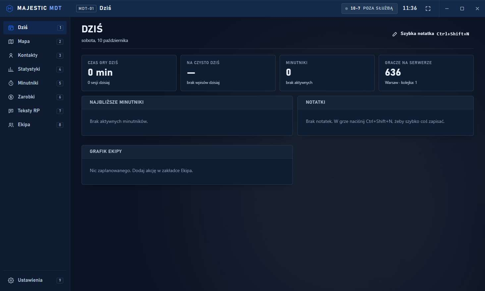
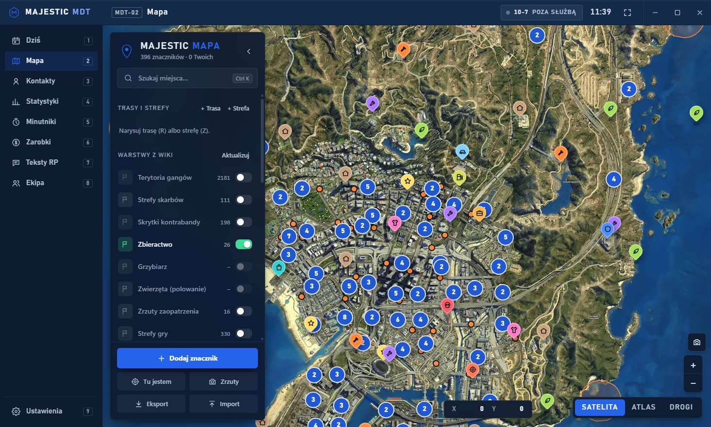
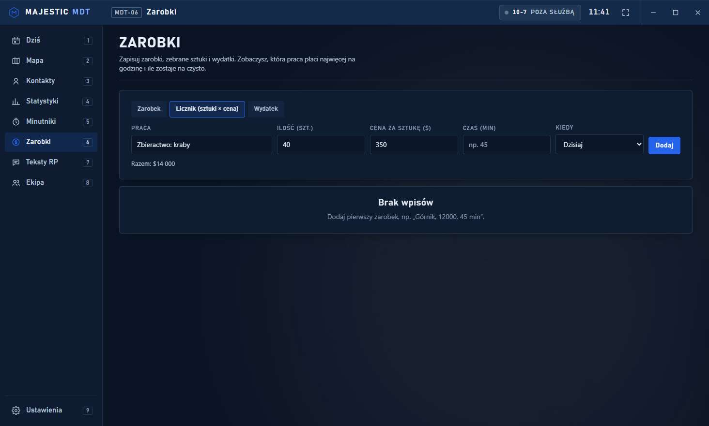

# Majestic Companion

Darmowa aplikacja na Windows dla graczy serwera **Majestic RP** (GTA V). Mapa ze znacznikami z wiki, kontakty, minutniki, zarobki, teksty RP i narzędzia dla ekipy w jednym oknie, w stylu terminala MDT.

**[⬇ Pobierz najnowszą wersję](https://github.com/777Sami777/majestic-companion/releases/latest)**: plik `MajesticCompanion.zip`. Wypakuj cały folder i uruchom `MajesticCompanion.exe`.



## Co potrafi

| Zakładka | Funkcje |
|---|---|
| **Dziś** | Czas gry, zarobek na czysto, minutniki, gracze na serwerze, grafik ekipy, kalendarz miesiąca, notatki i cele tygodnia na jednym ekranie |
| **Mapa** | 396 miejsc z Majestic Wiki, warstwy wiki (terytoria gangów, skrytki, zbieractwo, fotoradary, airdropy), własne znaczniki ze zrzutami ekranu, trasy i strefy, trasa przez strefy zbierania, przypomnienie o odnowieniu strefy, zmiany terytoriów, grupowanie znaczników, zdjęcie mapy do schowka, wyszukiwanie adresów, ranking ekipy tygodnia |
| **Kontakty** | Numery, frakcje, długi, historia, powiązanie z miejscem na mapie |
| **Statystyki** | Czas gry z logów launchera, liczba graczy na żywo, godziny szczytu, newsy Majestic |
| **Minutniki** | Cooldowny i wypłaty z powiadomieniem Windows |
| **Zarobki** | Zarobki, licznik sztuk × cena, wydatki, $/godz. dla każdej pracy, cele zakupowe, majątek z przypomnieniem o opłatach, najlepsza praca teraz, statystyki tygodni |
| **Postać i RP** | Karta postaci (też jako obrazek), generator, gotowe /me i /do, słownik, dziennik, kalkulator mandatów i wyroków, radio i kody |
| **Ekipa** | Grafik z przypomnieniami, magazyn, rozliczenie akcji (kto komu ile), raport na Discorda, kod ekipy |

Do tego: wyszukiwarka w całej aplikacji (**Ctrl+Space**), szybka notatka w grze (**Ctrl+Shift+N**), nakładka nad grą (**F10**), widżet nad grą (PayDay, minutniki, licznik zbierania na **Ctrl+Shift+Z/X**, cel zakupowy, notatka), notatka po sesji, raport tygodnia jako obrazek, powiadomienia na telefon (ntfy), profile kilku postaci, eksport CSV, lista zakupów do craftingu, notatki do terytoriów, 12 motywów (w tym LSPD, EMS i gangi), samouczek, wersja angielska, ikona w zasobniku, start z Windowsem i paczka danych dla kolegi.



## Bezpieczeństwo

- Aplikacja **nie ingeruje w grę** i nie czyta jej pamięci. Korzysta tylko z logów, które launcher Majestic sam zapisuje na dysku, oraz z publicznych stron (Majestic Wiki, publiczne API serwerów).
- Twoje dane zostają na Twoim komputerze (`%APPDATA%\MajesticMapa`).
- To projekt fanowski, niezwiązany z Majestic RP ani Rockstar Games.

## Wymagania

Windows 10 lub 11 z Microsoft Edge WebView2 (jest domyślnie w Windows 11).

## Budowanie ze źródeł

```bash
pip install pywebview pillow pystray pyinstaller
python -m PyInstaller --noconfirm --windowed --name MajesticCompanion --icon icon.ico --add-data "web;web" --add-data "wiki_extract.js;." --add-data "wiki_vehicles.js;." --add-data "wiki_crafting.js;." --add-data "warstwy_wiki.json;." --add-data "pojazdy.json;." --add-data "crafting.json;." --add-data "wiki_list.js;." --add-data "wiki_changelog.js;." --add-data "dane;dane" --add-data "icon.ico;." --hidden-import pystray._win32 main.py
```


